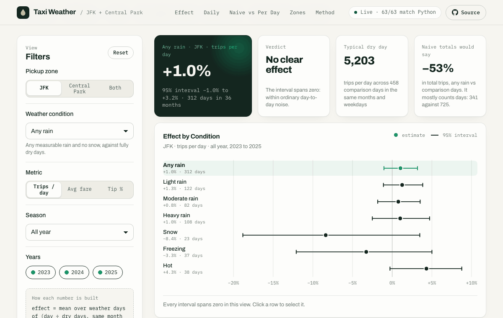
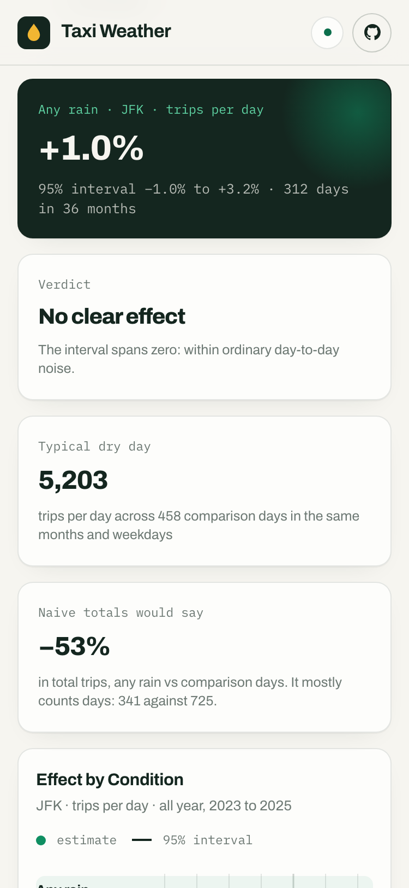
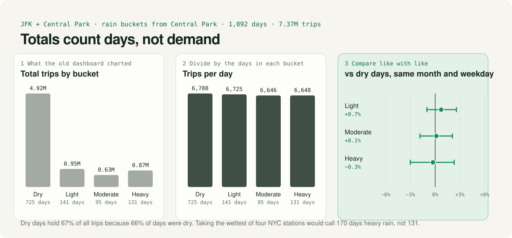
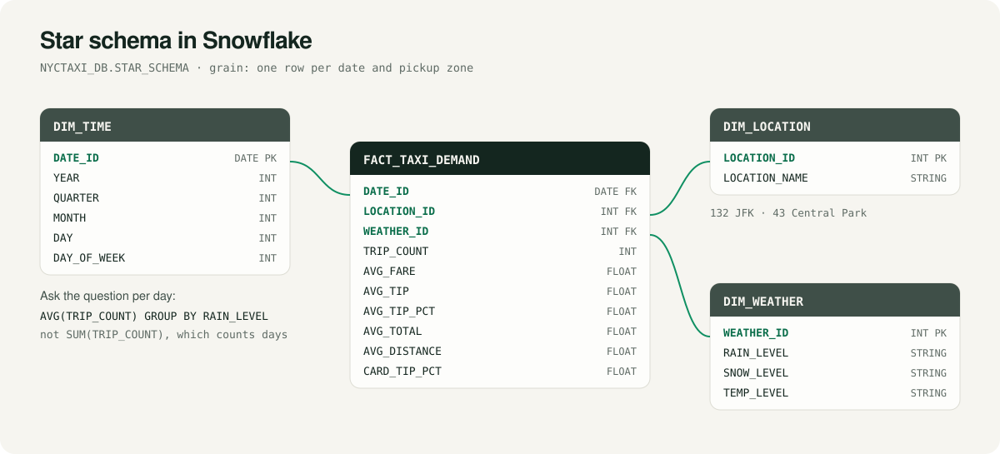

<p align="center"><a href="https://hansonyjy.github.io/end-to-end-nyc-taxi-analytics-pipeline/"></a></p>

<p align="center">
  <a href="https://hansonyjy.github.io/end-to-end-nyc-taxi-analytics-pipeline/"></a>
  
  
  
  
  
</p>

**Rain barely moves NYC taxi demand. Compared like for like, a rainy day at JFK runs +1.0% and at Central Park −1.2% against a dry one, and both intervals include zero.**

This is a cloud data pipeline (PySpark on Dataproc, a Snowflake star schema, Luigi orchestration) built to answer one question: does weather change how many people take a yellow taxi from JFK and from Central Park? It covers 7.37 million trips over 2023 to 2025. The first dashboard said yes. This repo explains why that answer was an artifact, and gives the honest one, with a dashboard where you can check it yourself.

It started as our MSBA 405 team project at UCLA Anderson (team 19). The team built the pipeline together, and teammate Zihan Ye published the [original Tableau dashboard](https://public.tableau.com/app/profile/zihan.ye/viz/405FinalProjectNYCTaxiWeatherDashboard/Dashboard1). I published the code and then came back to it on my own: I re-ran the analysis per day on the public data, traced the problems below to the Spark job, fixed the pipeline so the warehouse matches, and designed and built the new dashboard. I build with Claude Code as a pair programmer, and the history shows how: small commits, each with its reason in the message.

**Live dashboard:** [hansonyjy.github.io/end-to-end-nyc-taxi-analytics-pipeline](https://hansonyjy.github.io/end-to-end-nyc-taxi-analytics-pipeline/). It is a static site served by GitHub Pages from `/docs`, so it loads instantly and runs entirely in your browser.

## What You Can Do With It

- **Ask the question yourself.** Pick a zone (JFK, Central Park or both), a condition (any rain, light, moderate, heavy, snow, freezing, hot), a season and years, and a metric (trips per day, average fare, tip %). Every effect and interval is recomputed in your browser from the committed per-day table.
- **See the controlled effect first.** The headline card gives the effect against comparable dry days with its 95% interval and day count, and a plain verdict: no clear effect, clearly higher or clearly lower.
- **Watch the original mistake happen.** The naive panel shows the same days three ways: total trips per bucket (what was charted), trips per day, then like for like. A toggle replays the max-across-stations weather rule.
- **Compare an airport with a park.** JFK and Central Park side by side, condition by condition, with a profile of each zone.
- **Check the page against the analysis.** On load the dashboard recomputes all 63 effects (3 zones, 7 conditions, 3 metrics) and confirms they match `results.json` from the Python analysis. The status pill in the top bar says so.

It works on a phone: everything stacks at 375px with no sideways scroll.

<p align="center"></p>

## What We Found

<p align="center"></p>

Each weather day is compared only with dry days in the same month, the same year and on the same weekday, so season, weekday and the long-run trend (including congestion pricing from January 2025) cancel out.

- **Rain does not move demand.** On 312 rainy days, JFK ran +1.0% (95% interval −1.0% to +3.2%) and Central Park −1.2% (−3.2% to +1.1%). Even heavy rain, over 0.3 inches, gives +1.0% at JFK (−2.5% to +4.7%) and −2.5% at Central Park (−6.7% to +2.4%) across 108 days.
- **The one rain number that clears zero is small.** A regression with month and weekday fixed effects puts heavy rain at Central Park at −3.3% (−5.8% to −0.9%). Even taken at face value, that is about 50 fewer pickups on a 1,600-trip day.
- **Snow and heat show at Central Park, on few days.** Snow days ran −4.8% (−9.6% to −0.9%, 23 days) and hot days of 80°F and up ran +5.9% (+2.3% to +9.2%, 38 days). With seven conditions tested, treat these as leads, not findings.
- **Fares and tips barely move.** A rainy day lifts the average Central Park fare by 0.6% (+0.1% to +1.3%), and the card tip rate does not change at either zone.

JFK is booked by flights, not by the sky, so a flat airport line was expected. The surprise is that a curbside zone like Central Park is nearly as flat.

### Why the First Dashboard Said Otherwise

<p align="center"></p>

The Tableau view charted **total** trips per weather bucket. A bucket with more days always holds more trips, so the chart mostly measured how often each kind of weather happens: dry days hold 67% of all trips because 66% of days were dry. Divided by days, the buckets sit within about 2% of each other (dry 6,788 trips per day, heavy rain 6,648), and like for like the gap closes to −0.3%.

Two pipeline choices made it worse. The weather came from the **maximum** precipitation across every station in the NOAA export, so a shower at any one gauge turned the whole city into a rain day: even with only four NYC airport-class stations, the max rule labels 170 days heavy rain instead of 131. And the Spark job's de-duplication keyed on the pickup **date** and the fare, which merged different trips and silently dropped **45% of Central Park pickups** and 9% of JFK pickups. Busy days lost the most, which flattens exactly the variation the project set out to measure. Temperature and monthly charts were confounded by season as well, since cold days are winter days.

## How It Works

<p align="center"></p>

- **The cloud pipeline.** `./pipeline.py` runs two Luigi tasks: submit `Spark/spark-job.py` to Dataproc, then run `Snowflake/snowflake_load.sql` through SnowSQL. Spark cleans 36 monthly files, keeps JFK (TLC zone 132) and Central Park (zone 43), joins one row of weather per day and writes a star schema to GCS; Snowflake loads it.
- **The local re-analysis.** `analysis/weather_effect.py` downloads the same public files and applies the same rules with DuckDB on a laptop in about 20 seconds. It writes the per-day table and the results, and reruns byte for byte.
- **One rulebook.** Trip filters, the duplicate rule, the station and the data-gap rule are identical in both paths, so the warehouse's daily trip counts match the committed table. The full rules are in [`docs/pipeline.md`](docs/pipeline.md).

<p align="center"></p>

## Design Decisions

- **A star schema at the grain of the question.** One fact row per date and pickup zone, with time, location and weather as dimensions. Demand is a daily quantity, so the warehouse stores it daily; any rollup is one `GROUP BY` away, and `V_TRIPS_PER_DAY_BY_RAIN` ships the right one.
- **Aggregate in Spark, not in the warehouse.** About 107 million valid trips reduce to 2,184 fact rows before they leave Dataproc. Snowflake stores what analysts query, and the dashboard's whole dataset is a 310 KB CSV.
- **Luigi marker files for idempotent reruns.** Each task writes a marker on success and Luigi skips tasks whose marker exists. A plain run clears them and rebuilds; `--keep-flags` retries only the stage that failed. Snowflake tables are recreated, not appended, so a rerun never doubles a row.
- **Two zones, chosen to disagree.** An airport queue driven by flight schedules and a park where pickups are a choice made on the curb. If weather mattered anywhere, it should show at Central Park first, and the comparison would tell us why.
- **Per day, like for like, instead of totals.** A total mixes how much demand there is with how many days a bucket has. Trips per day fixes the second; matching each weather day with dry days in its own month and weekday fixes season and trend.
- **Show the intervals, not just the dots.** Every effect carries a 95% interval and its day count, and the dashboard says "no clear effect" when the interval spans zero rather than letting a +1.0% read as a result.

## Design Principles, and Why Each Exists

**1. Every number is computed, never typed.**
The figures in this README are drawn from `results.json` by `docs/figures.py`, and the dashboard recomputes every effect from `daily.csv`. *(A test recomputes the headline effects from the committed table and asserts they match `results.json`.)*

**2. Compare like with like.**
A rainy Tuesday in March is compared with dry Tuesdays in that same March. *(Without it, the temperature chart is a seasonality chart.)*

**3. One ruler for weather.**
Every day's weather comes from one station, Central Park. *(Taking the wettest of many gauges turned 39 extra days into heavy rain with only four stations.)*

**4. A duplicate is an exact repeat.**
Two trips are the same trip only when every field matches. *(The date-level rule merged different trips and removed 45% of Central Park pickups.)*

**5. The browser and the analysis must agree, and prove it.**
The dashboard's estimator and its seeded bootstrap (mulberry32) mirror the Python bit for bit, and it checks all 63 effects against `results.json` on every load. *(A test pins the generator's first draws so the two cannot drift.)*

## Assumptions, Stated Plainly

- **One station stands for the city.** NOAA's Central Park station (USW00094728) is the weather for both zones, including JFK about 14 miles away. The alternative, the max across stations, is what inflated the rain buckets. Central Park does not report a daily average temperature for these years, so it is the mean of the high and low, NOAA's own convention for normals.
- **What the original dashboard got wrong.** It summed trips per bucket instead of averaging per day, used max-across-stations rain, lost much of Central Park to the date-level dedupe, and did not control for season. Its numbers came from the pipeline as it was then; this repo fixes the pipeline, but I have not changed the published Tableau workbook, which belongs to its author.
- **Buckets keep the team's thresholds.** Light rain is up to 0.1 inches, moderate up to 0.3, heavy above 0.3; hot is a daily average of 80°F and up, freezing below 32°F.
- **Excluded days.** 33 federal holidays (unusual demand for reasons other than weather) and four days, 2023-09-21 to 2023-09-24, when the raw TLC files are nearly empty citywide.
- **Tip % is card trips only.** Cash tips are not recorded, so the tip rate is card tips over card fares.
- **Association, not a forecast.** These are three years at two zones. They say rain has not mattered much here, not that it never could.

## Engineering Notes

- **Reproducible to the byte.** DuckDB sums in parallel, which can change the last bits of a float between runs, so money is rounded to cents before any estimate. Two runs produce identical `results.json` files.
- **Data gaps are detected, not hardcoded.** A day is a gap when any hour from 08:00 to 21:59 has fewer than 300 raw records citywide. It flags exactly the four September 2023 days; the quietest daytime hour of Christmas 2023 still had 894.
- **Fast enough to recompute on every click.** The bootstrap resamples whole months 2,000 times over precomputed per-month sums, so the 24 intervals on screen recompute in about 25 ms on a laptop.
- **Clustered uncertainty.** Days in the same month share shocks (a strike, a holiday week, a fare change), so the bootstrap resamples months, not days. The regression uses HAC standard errors for the same reason.
- **What was not run.** The Spark and Snowflake changes are written to produce the same numbers as the analysis script but have not been executed on Dataproc or Snowflake since the fix; the local analysis, the tests and the dashboard have.

## Repository Map

```
analysis/weather_effect.py   downloads TLC + NOAA data, rebuilds daily.csv and results.json
Spark/spark-job.py           PySpark ETL on Dataproc: clean, dedupe, one station, star schema
Snowflake/snowflake_load.sql stage, star schema tables, COPY INTO, per-day view, checks
Luigi/pipeline.py            Luigi tasks: RunSparkJob, LoadToSnowflake, FullPipeline
pipeline.py                  entry point: preflight checks, then the Luigi run
docs/index.html, app.*       the dashboard (static, Chart.js 4.4.3, no build step)
docs/data/                   committed outputs: daily.csv, results.json
docs/figures.py, capture.py  README figures from results.json; dashboard GIF and phone shot
docs/pipeline.md             stage-by-stage pipeline reference
tests/                       data-quality checks and a recompute-from-the-table check
```

## Run It Yourself

<details>
<summary><b>The analysis and the dashboard</b> (no accounts, about 2 GB of downloads)</summary>

```bash
pip install -r requirements.txt
python analysis/weather_effect.py --download   # fetches 36 TLC files and NOAA data into data/raw/
python -m pytest -q
python docs/figures.py                         # redraw the README figures
python -m http.server 8765 --directory docs    # then open http://localhost:8765
```

`docs/capture.py` re-records the GIF and phone screenshot from that server (needs Google Chrome, Pillow and websocket-client).

</details>

<details>
<summary><b>The full cloud pipeline</b> (GCP and Snowflake accounts)</summary>

You need a GCS bucket, a Dataproc cluster in the same project, a Snowflake account, `gcloud` authenticated to the project, and SnowSQL installed.

1. Download the TLC yellow taxi parquet files for 2023 to 2025 from the [TLC trip record page](https://www.nyc.gov/site/tlc/about/tlc-trip-record-data.page) into `gs://your-bucket/NYC-taxi/`, and a NOAA daily CSV that includes station `USW00094728` (PRCP, SNOW, TMAX, TMIN) from [Climate Data Online](https://www.ncei.noaa.gov/cdo-web/) to `gs://your-bucket/Weather.csv`. `analysis/weather_effect.py --download` fetches both if you want a copy to upload.
2. Copy the config and fill in your values:

   ```bash
   cp .env.example .env
   ```

3. Run the pipeline:

   ```bash
   ./pipeline.py
   ```

   It checks for `gcloud`, `snowsql` and every required variable first, and lists anything missing. If a tool is not on your `PATH`, set `GCLOUD_BIN` or `SNOWSQL_BIN` in `.env`. After a Snowflake failure, `./pipeline.py --keep-flags` retries only that stage.

The repo ships no credentials. Stage-by-stage details are in [`docs/pipeline.md`](docs/pipeline.md).

</details>

## About

Built by **Hanson Yang**: MSBA, UCLA Anderson (Dec 2026); B.Com Finance, UBC. Originally an MSBA 405 team project (team 19), with the original Tableau dashboard published by Zihan Ye.

*Portfolio project on public NYC TLC and NOAA data. Not affiliated with either agency.*
